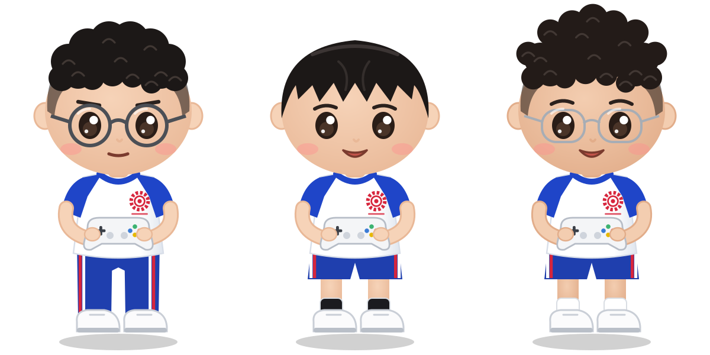

# Skyfence 3v3 無人機足球

依 FAI F9A 無人機足球規則建構的瀏覽器 3D 模擬賽場。免安裝，開網頁就能玩 3 對 3，可用鍵盤、USB 遊戲手把／遙控器，或透過 Arduino 接 PS2 無線手把操控。

## 線上遊玩

啟用 GitHub Pages 後，網址為：

```
https://<你的帳號>.github.io/<儲存庫名稱>/
```

要用 Arduino（序列埠）或 USB 手把，請使用電腦版 **Chrome** 或 **Edge**。GitHub Pages 是 HTTPS 網址，可以直接使用 Web Serial。

## 飛手角色



三位 Q 版飛手穿校隊運動服，站在籠外飛手區；在設定選單點選角色即可決定要操控誰，名字可直接修改。

## 比賽規則（FAI F9A）

- 每隊 3 架：1 架 Striker、2 架 Guide／Keeper。只有 Striker 能得分。
- 三局制，每局 3 分鐘；先贏兩局者勝，否則進行黃金進球延長賽。
- 開賽前裁判宣布「Arm your quads」，約 3–5 秒後鳴聲開賽；鳴聲前離地判對方罰球。
- Striker 須整顆球機、朝對方底線方向完整穿過對方球門環才算得分。
- 進球後得分隊全員須回到己方半場，才能再次得分；違規判對方罰球。
- Striker 以外的隊員穿越或停在己方球門內，判對方罰球。
- 罰球：Striker 對一名防守者，限時 10 秒，不計入該局時間。

## 賽場規格

| 規格 | 飛行區 | 籠高 | 球機直徑 | 球門外徑／內徑 | 距底線 |
|---|---|---|---|---|---|
| F9A-B | 6 × 3 m | 3 m | 20 cm | 70 / 40 cm | 1 m |
| F9A-A | 14 × 7 m | 5 m | 40 cm | 100 / 60 cm | 1.5 m |

球門懸掛高度為本模擬的設定值（FAI 只規定懸掛於籠頂）。

## 操作

| 動作 | 鍵盤 | PS2 手把 |
|---|---|---|
| 升降（油門） | W / S | 左搖桿上下 |
| 轉向（偏航） | A / D | 左搖桿左右 |
| 前後／左右 | 方向鍵 | 右搖桿 |
| 換操控的球機 | Tab | SELECT |
| 切換視角 | C | △ |
| 切換飛行模式 | F | □ |
| 暫停 | P | START |
| 設定選單 | Esc | — |

## Arduino PS2 手把

1. 安裝函式庫 [Arduino-PS2X](https://github.com/madsci1016/Arduino-PS2X)。
2. 接線：DAT→D12、CMD→D11、ATT→D10、CLK→D13、GND→GND、VCC→**3.3V**。
3. 上傳 `arduino/PS2_DroneSoccer/PS2_DroneSoccer.ino`。
4. 開啟網頁 → 操控裝置選「Arduino PS2（序列埠）」→「連接 Arduino」→ 選 COM 埠（115200 baud）。

序列埠格式：`J,LX,LY,RX,RY,按鍵(16進位),模式(16進位)`，每 20 ms 一行。

### X 軸沒有反應

在 Arduino 序列埠監控視窗輸入 `d` 開啟診斷模式：

- 模式不是 `0x73` / `0x79`：按手把 ANALOG 鍵讓紅燈亮。
- 某軸最小／最大值從未改變：接收器改接 3.3V；副廠手把按一次 MODE 鍵；或在 `PS2X_lib.h` 的 AVR 區段把 `CTRL_CLK` 改為 10、`CTRL_BYTE_DELAY` 改為 15。

## 技術

單一 HTML 檔，使用 [three.js r128](https://threejs.org/)（CDN 載入），Web Serial API 與 Gamepad API。

## 參考資料

- [FAI Drone Sports – F9A Sporting Rules](https://www.fai.org/node/199604)
- [FAI Sporting Code Volume F9 Drone Sports](https://www.fai.org/)
- [傑森創工：Arduino 結合 PS2 無線手把簡單上手](https://blog.jmaker.com.tw/ps2x/)
