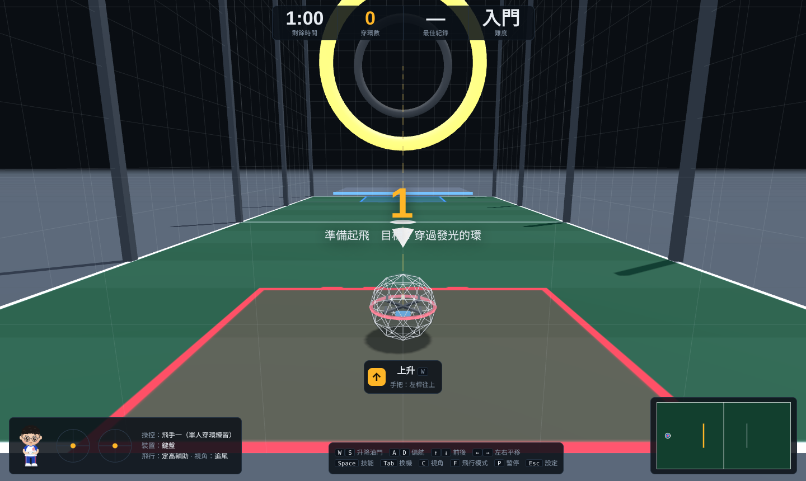
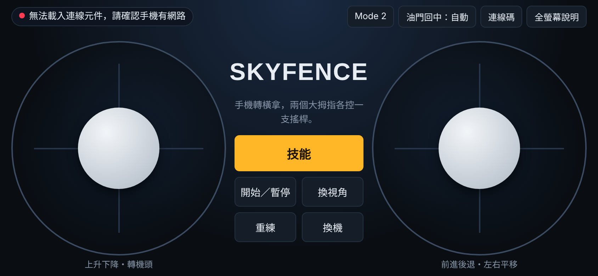
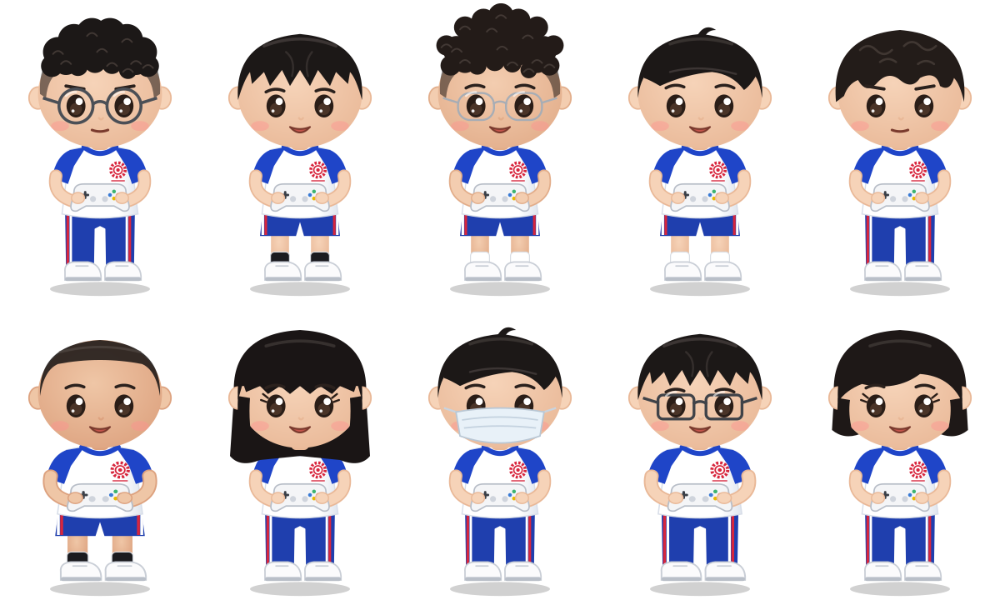
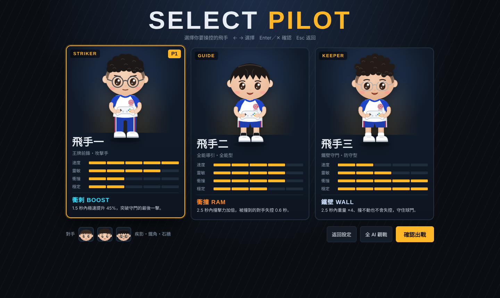

# Skyfence 3v3 無人機足球

依 FAI F9A 無人機足球規則建構的瀏覽器 3D 模擬賽場。免安裝，開網頁就能玩 3 對 3，可用鍵盤、USB 遊戲手把／遙控器，或透過 Arduino 接 PS2 無線手把操控。

## 線上遊玩

啟用 GitHub Pages 後，網址為：

```
https://<你的帳號>.github.io/<儲存庫名稱>/
```

要用 Arduino（序列埠）或 USB 手把，請使用電腦版 **Chrome** 或 **Edge**。GitHub Pages 是 HTTPS 網址，可以直接使用 Web Serial。

## 新手上路：單人穿環練習



設定選單最上方的「單人穿環練習」讓新手熟悉手控：在計時內穿過發光的環，計算穿環數。

- **時間**：1 分鐘、3 分鐘，或不計時的自由練習。
- **難度**：入門（大環，依序練 直飛 → 上升 → 下降 → 左移 → 右移 → 右轉 → 左轉，之後隨機）、標準（中環、轉角較大）、挑戰（與球門同尺寸的小環，必須照箭頭方向穿過）。
- **操作提示**：畫面下方即時顯示下一步該做的動作（上升、右轉、左移、前進…），同時標出鍵盤按鍵與手把該推哪支桿。
- 虛線導引從球機指向目標環，下一個環以半透明預告；結束時顯示穿環數、平均與最快秒數、撞網次數，並記錄各賽場、時間、難度的最佳紀錄。
- 練習中所有球機能力相同、不使用技能。按 **R** 或 **Enter**（結束後）可立即重練。

## 手機當遙控器

沒有實體遙控器時，可以用手機當搖桿，電腦負責顯示畫面。

1. 電腦開啟網站 → 設定選單「操控裝置」選 **手機當遙控器**（或練習卡片上的「用手機當搖桿」）。
2. 畫面會出現 QR code 和 6 位數連線碼。手機相機掃描 QR code 開啟連結（或在手機開 `?pad=` 頁面輸入連線碼）。
3. 手機轉橫拿：左右兩個圓圈是搖桿（預設 Mode 2：左手上升下降・轉機頭，右手前進後退・左右平移），可切換 Mode 1。
4. 手機上另有「技能、開始／暫停、換視角、重練、換機」按鈕；穿環、進球、撞網時手機會震動（Android）。

- 連線使用 WebRTC（[PeerJS](https://peerjs.com/) 免費連線服務），手機與電腦都需要能上網，連同一個 Wi-Fi 最穩定。
- 手機訊號中斷超過 0.6 秒，球機會自動放開搖桿。
- **全螢幕**：Android 按「全螢幕」即可。iPhone 的 Safari 不支援網頁全螢幕，請按 Safari「分享」→「加入主畫面」，之後從主畫面的「Skyfence 遙控」圖示開啟，就沒有網址列，也會記住連線碼（電腦的連線碼固定不變，除非按「換一組連線碼」）。
- 「油門回中」預設自動：定高輔助模式下放開就回中；手動油門模式下油門桿會停在原位，像真的遙控器。



## 飛手角色



10 位 Q 版飛手，全員穿藍白校隊體育服，名字可在設定選單直接修改。

### 選角與技能（電玩模式）



按「開始比賽」進入 **SELECT PILOT**：方向鍵在名單中挑選飛手，Q／E（PS2 為 L1／R1）切換出戰位置，隊伍陣容會自動補上適合的隊友，也可以用 ‹ › 更換。確認後進入 VS 對戰畫面，比賽中記分板兩側顯示雙方頭像與技能冷卻條。

| 類型 | 技能 | 效果 | 名單 |
|---|---|---|---|
| 攻擊手 | **衝刺 BOOST** | 1.5 秒極速 +45% | 王牌前鋒、陽光射手、閃電射手 |
| 全能型 | **衝撞 RAM** | 2.5 秒撞擊力加倍，被撞對手失控 0.6 秒 | 全能導引、長程導引、推土機、冷靜指揮、靈巧導引 |
| 防守型 | **鐵壁 WALL** | 2.5 秒重量 ×4、不會失控 | 鐵壁守門、精算守門 |

每位飛手的速度、靈敏、衝撞、穩定（1–5）都不同，會實際影響最高速度、反應、碰撞與失控門檻。

技能鍵：鍵盤 **Space**（或 E）、PS2 **✕** 或 **R1**、USB 手把 **A／R1**。選單可切換為 **競技模式**：所有球機能力相同、不使用技能，完全依 FAI 標準。

## 比賽規則（FAI F9A）

- 每隊 3 架：1 架 Striker、2 架 Guide／Keeper。只有 Striker 能得分。
- 三局制，每局 3 分鐘；先贏兩局者勝，否則進行黃金進球延長賽。
- 開賽前裁判宣布「Arm your quads」，約 3–5 秒後鳴聲開賽；鳴聲前離地判對方罰球。
- Striker 須整顆球機、朝對方底線方向完整穿過對方球門環才算得分。
- 進球後得分隊全員須回到己方半場，才能再次得分；違規判對方罰球。
- Striker 以外的隊員穿越或停在己方球門內，判對方罰球。
- 罰球：Striker 對一名防守者，限時 10 秒，不計入該局時間。

## 賽場規格

| 規格 | 飛行區 | 籠高 | 球機直徑 | 球門外徑／內徑 | 距底線 |
|---|---|---|---|---|---|
| F9A-B | 6 × 3 m | 3 m | 20 cm | 70 / 40 cm | 1 m |
| F9A-A | 14 × 7 m | 5 m | 40 cm | 100 / 60 cm | 1.5 m |

球門懸掛高度為本模擬的設定值（FAI 只規定懸掛於籠頂）。

## 操作

| 動作 | 鍵盤 | PS2 手把 |
|---|---|---|
| 升降（油門） | W / S | 左搖桿上下 |
| 轉向（偏航） | A / D | 左搖桿左右 |
| 前後／左右 | 方向鍵 | 右搖桿 |
| 換操控的球機 | Tab | SELECT |
| 切換視角 | C | △ |
| 切換飛行模式 | F | □ |
| 施放技能 | Space / E | ✕ 或 R1 |
| 暫停 | P | START |
| 設定選單 | Esc | — |

## Arduino PS2 手把

1. 安裝函式庫 [Arduino-PS2X](https://github.com/madsci1016/Arduino-PS2X)。
2. 接線：DAT→D12、CMD→D11、ATT→D10、CLK→D13、GND→GND、VCC→**3.3V**。
3. 上傳 `arduino/PS2_DroneSoccer/PS2_DroneSoccer.ino`。
4. 開啟網頁 → 操控裝置選「Arduino PS2（序列埠）」→「連接 Arduino」→ 選 COM 埠（115200 baud）。

序列埠格式：`J,LX,LY,RX,RY,按鍵(16進位),模式(16進位)`，每 20 ms 一行。

### X 軸沒有反應

在 Arduino 序列埠監控視窗輸入 `d` 開啟診斷模式：

- 模式不是 `0x73` / `0x79`：按手把 ANALOG 鍵讓紅燈亮。
- 某軸最小／最大值從未改變：接收器改接 3.3V；副廠手把按一次 MODE 鍵；或在 `PS2X_lib.h` 的 AVR 區段把 `CTRL_CLK` 改為 10、`CTRL_BYTE_DELAY` 改為 15。

## 技術

單一 HTML 檔，使用 [three.js r128](https://threejs.org/)（CDN 載入），Web Serial API 與 Gamepad API。

## 參考資料

- [FAI Drone Sports – F9A Sporting Rules](https://www.fai.org/node/199604)
- [FAI Sporting Code Volume F9 Drone Sports](https://www.fai.org/)
- [傑森創工：Arduino 結合 PS2 無線手把簡單上手](https://blog.jmaker.com.tw/ps2x/)
